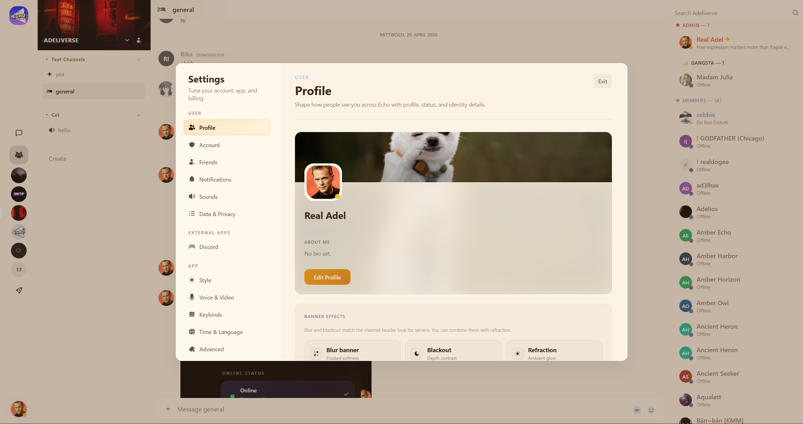

<p align="center">
  
</p>

<p align="center">
  <strong>Echo</strong> — a real Discord alternative: chat, voice, and communities.<br>
  Use it at <a href="https://chat-echo.com">chat-echo.com</a> · learn more at <a href="https://app-echo.net">app-echo.net</a> · or self-host / fork (AGPL).
</p>

<p align="center">
  <a href="./LICENSE"></a>
  <a href="./docs/DEVELOPMENT.md"></a>
  <a href="https://github.com/ad3lre/echo/actions/workflows/echo-format-ci.yml"></a>
  <a href="https://github.com/ad3lre/echo/actions/workflows/echo-backend-ci.yml"></a>
  <a href="https://github.com/ad3lre/echo/actions/workflows/echo-web-ci.yml"></a>
  <a href="https://github.com/ad3lre/echo/actions/workflows/codeql.yml"></a>
</p>

<p align="center">
  
</p>

# Echo

Echo is a full-stack **Discord alternative** for communities: realtime **chat**, **voice and video** (LiveKit), servers and channels, DMs, roles, and the workflows people expect from a modern team or social space—without treating your community as ad inventory.

**Hosted product (live today):**

|                   |                                        |
| ----------------- | -------------------------------------- |
| App               | [chat-echo.com](https://chat-echo.com) |
| Marketing & legal | [app-echo.net](https://app-echo.net)   |

This repository is the same stack that powers those sites. You can join the hosted service, run your own instance, or fork under AGPL—same product either way.

## Quick start

Bun **1.4.2+** and Docker (Postgres):

```bash
bun install --frozen-lockfile
cp .env.example .env
bun run db:up
bun run dev:core
```

| Service  | URL                   |
| -------- | --------------------- |
| API      | http://localhost:3000 |
| Vite SPA | http://localhost:8080 |

`dev:core` starts the API and web client. Use `bun run dev` when you also need the Discord bot and activities worker.

Full setup, PR checks, and maintainer notes: **[docs/DEVELOPMENT.md](./docs/DEVELOPMENT.md)**. Doc index: **[docs/README.md](./docs/README.md)**.

## Why Echo

- **A working product, not a demo** — the hosted app at [chat-echo.com](https://chat-echo.com) is a full Discord-style community platform; this repo is what runs it.
- **Privacy and consent by design** — clear boundaries for data, sessions, and what the server may assume about users.
- **Realtime-first** — chat and presence are first-class; voice/video follow a documented LiveKit path with production checklists in-repo.
- **Self-host when you want control** — no mandatory third-party control plane; configure auth, storage, voice, and edge for your threat model (see [operator setup](#getting-started-operators) and [VPS deploy](./docs/operations/linux-vps-deployment.md)).
- **Engineering guardrails** — contract and security tests, RBAC and snowflake guards in CI, observability hooks, [shipping gate](./docs/operations/shipping-gate.md), [production security checklist](./docs/operations/PRODUCTION_SECURITY_CHECKLIST.md).
- **Installable where users are** — **PWA** for the web and **native Apple apps** in [`clients/apple/`](./clients/apple/).

## Project structure

Single monorepo. Full map: **[docs/overview/repo-layout.md](./docs/overview/repo-layout.md)**.

| Path                     | Role                                                                  |
| ------------------------ | --------------------------------------------------------------------- |
| `clients/web/`           | Vue 3 + Vite SPA (Pinia, TypeScript; History API nav, not vue-router) |
| `clients/apple/`         | Native SwiftUI iOS/macOS clients                                      |
| `server/backend/`        | Fastify REST, Socket.IO, Postgres, auth and domain logic              |
| `contracts/`             | Shared TypeScript types/constants (client ↔ server)                   |
| `server/backend/crypto/` | E2EE + MLS kit                                                        |
| `server/media/`          | Media CDN + chat video HLS worker                                     |
| `server/voice/`          | Voice helper sidecar (LiveKit-adjacent)                               |
| `server/activities/`     | VC gamespace sidecar + shared game cores                              |
| `server/ops/`            | Scripts, infra, monitoring, perf                                      |
| `marketing/`             | Astro public site                                                     |
| `bot/`                   | Optional Discord bridge / import tooling                              |
| `docs/`                  | Public docs (contracts, self-host runbooks)                           |

## Stack

| Layer    | Choices                                                                                                           |
| -------- | ----------------------------------------------------------------------------------------------------------------- |
| Frontend | Vue 3, Vite, Pinia, TypeScript                                                                                    |
| Backend  | Bun, Fastify, Socket.IO, TypeScript                                                                               |
| Data     | PostgreSQL                                                                                                        |
| Realtime | Optional **NATS** Socket.IO adapter when `NATS_URL` is set — [realtime scaling](./docs/infra/realtime-scaling.md) |
| Voice    | LiveKit — [livekit-production.md](./docs/operations/livekit-production.md)                                        |
| Storage  | S3-compatible when `ECHO_S3_*` is configured (optional)                                                           |

## Getting started (operators)

- Install from the **repo root** (`bun install --frozen-lockfile`). Root workspaces + `sharp` (Twemoji) are required; `clients/web/` alone is not enough.
- Local: `bun run db:up` then `bun run dev:core`. Postgres mode: `ECHO_BACKEND_STORAGE=postgres` and `DATABASE_URL`.
- Production-like local: `bun run prod` (API **:3000**, Vite preview **:4173**). Skip rebuild: `bun run prod:serve`.
- Seed (API running): `bun run seed:dev`.
- VPS / bare metal: [linux-vps-deployment.md](./docs/operations/linux-vps-deployment.md).

### Progressive Web App

Manifest + icons under `clients/web/public/icons/` (regenerated on web build) and `clients/web/public/sw.js`. Chrome can offer **Install Echo** on `bun run dev:core` (http://localhost:8080). Icons only: `bun run pwa:icons`.

## Native apps

First-party SwiftUI clients (not a WebView shell): [`clients/apple/README.md`](./clients/apple/README.md). Passkeys: [`docs/operations/ios-passkeys.md`](./docs/operations/ios-passkeys.md).

## Contributing

Public contributions on **GitHub**. Start with [docs/DEVELOPMENT.md](./docs/DEVELOPMENT.md), then [CONTRIBUTING.md](./CONTRIBUTING.md) and [CODE_OF_CONDUCT.md](./CODE_OF_CONDUCT.md). Security: [`.github/SECURITY.md`](./.github/SECURITY.md).

Before a PR: `./server/ops/scripts/setup-githooks.sh` (once), then `bun run ci:precheck`.

CI on `main` (format, backend, web, CodeQL) is shown in the badges above. E2E smoke runs on pull requests and release publishes (`echo-e2e-ci.yml`), not on every `main` push.

## Third-party assets

Icons and emoji: [marketing/terms/en-US/ATTRIBUTIONS.md](./marketing/terms/en-US/ATTRIBUTIONS.md).

## License

**GNU Affero General Public License v3.0 only** — see [`LICENSE`](./LICENSE).

If you **modify** this program and **offer** it as a **network service**, the AGPL requires offering **Corresponding Source** to users of that service under the same license. See the [GNU AGPL howto](https://www.gnu.org/licenses/agpl-3.0.html).
